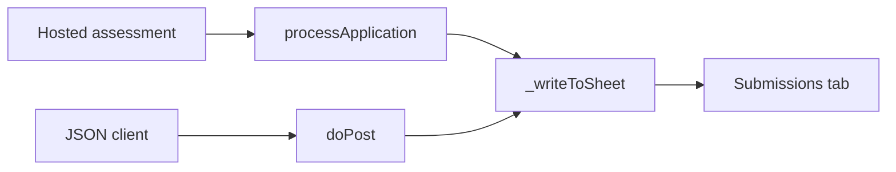

# 🔥 Phoenix Guild Backend

The **Empyreal Seeker Assessment** is a guild application that reads like a paper questionnaire. Seekers answer seven prompts on one page. In Apps Script, the form sends those answers to a handler that appends one row to a Google Sheet.

## 📑 Table of contents

[Features](#-core-features) · [Architecture](#-architecture-and-tech-stack) · [Quick start](#-quick-start) · [Deployment](#-deployment-and-status) · [Layout](#-repository-layout) · [Contributing](#-contributing) · [License](#-license)

## 🚀 Core features

| What happens | Where to look |
|---|---|
| A seeker fills in three introductory fields and four longer answers on a ruled form. The browser trims each answer, checks the preferred name and shows either confirmation or a submission error. | [Form and submit handler](Index.html) |
| The hosted form calls `processApplication`. The handler checks for a nonblank preferred name and assigns a UTC timestamp before writing. | [RPC handler](Code.gs) |
| A legacy JSON POST route uses the same writer. It accepts a supplied timestamp and skips the RPC name check. Its JSON response reports success or error in `result`. | [POST handler](Code.gs) |
| The writer waits up to ten seconds for a script lock. It creates the `Submissions` tab if needed, adds and freezes the header on an empty tab, then appends eight columns in a fixed order. | [Sheet writer](Code.gs) |
| A maintainer can run `runHealthCheck` to log and return two results covering script execution and an outbound request to Google. | [Health check](monitoring.gs) |

## 🏗️ Architecture and tech stack

`doGet` serves the HTML, CSS and browser JavaScript through HtmlService. The server uses the Apps Script V8 runtime, LockService and SpreadsheetApp. [Web app entry points](Code.gs) · [Runtime manifest](appsscript.json)



## ⚡ Quick start

From the repository root in PowerShell, open the form locally.

```powershell
Start-Process .\Index.html
```

Enter sample answers and submit. The local preview prints the payload in the browser console and displays the confirmation after a short delay. It works without an Apps Script login. Spreadsheet persistence requires the hosted path.

## ☁️ Deployment and status

1. For a test deployment, open a disposable Google Sheet and choose **Extensions → Apps Script**. Copy in [Code.gs](Code.gs), [Index.html](Index.html), [monitoring.gs](monitoring.gs) and the [manifest](appsscript.json).
2. In the Apps Script editor, choose **Deploy → New deployment → Web app**. Review access before deploying. The repository manifest specifies execution as the deployer and anonymous access.
3. Submit a synthetic application through the web app and inspect the spreadsheet for the corresponding timestamped row. The writer calls `getActiveSpreadsheet()` and throws if the hosted execution has no active spreadsheet. A bound project still needs this end-to-end check.

For clasp users, the checkout contains an existing project binding. Target your own test project before syncing. The [deployment workflow](.github/workflows/deploy.yml) shows source upload and deployment as separate commands, `clasp push` and `clasp deploy`.

**Verification gap.** The included health check does not submit an application, check the spreadsheet, count submissions or measure lock contention. A live deployment and successful hosted write have yet to be verified for this refresh.

## 🗂️ Repository layout

| Path | Purpose |
|---|---|
| [Index.html](Index.html) | Assessment layout, form fields and browser submission logic |
| [Code.gs](Code.gs) | Web entry points, RPC validation and spreadsheet writes |
| [monitoring.gs](monitoring.gs) | Manually callable execution and connectivity checks |
| [appsscript.json](appsscript.json) | Runtime and web app settings |
| [releases/](releases/) | Packaged project archive |
| [assets/banner/](assets/banner/) | README artwork, [editable vector](assets/banner/banner.svg) and [art direction](assets/banner/BANNER_BRIEF.md) |

## 🤝 Contributing

When changing a question, follow its field ID from the HTML through the submit handler to the header and row mapping in the writer. Preview the form locally, then check a synthetic row in a test sheet before opening a pull request.

## 📄 License

Distributed under the [MIT License](LICENSE).
